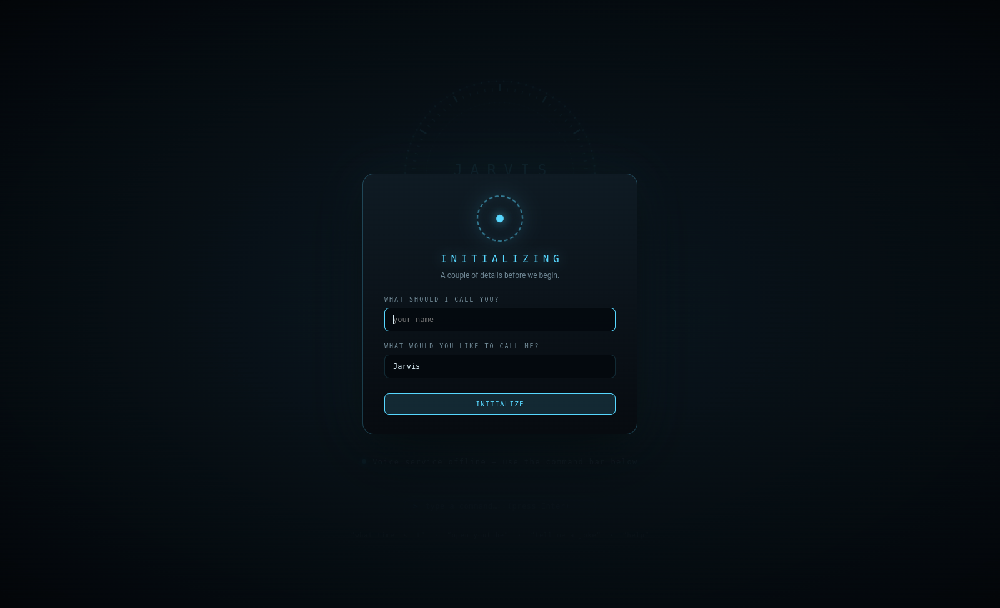

# JARVIS — Voice-Activated Desktop Assistant

A voice-activated desktop assistant with a sci-fi HUD interface, inspired by Marvel's J.A.R.V.I.S. Ask it anything and it speaks the answer back using the AI provider of your choice.


## Features

- 🎙️ **Wake word** — say your assistant's name (chosen on first launch) to activate it
- 🤖 **Four AI providers** — OpenAI, Claude, Gemini, or Groq — ask anything and hear the answer spoken aloud
- 🗣️ **Voice commands** — time, open apps, web search, jokes, settings, shutdown
- ⌨️ **Typed fallback** — a command bar for when you don't want to speak
- 🌌 **Animated HUD** — segmented cyan ring, live clock, date, and listening waveform
- 🔐 **Local keys** — API keys are encrypted and stored on your machine, never in the cloud
- 📦 **Linux `.deb`** — ready to install on Linux Mint / Ubuntu / Debian

## First launch



On first open, a small popup asks:

1. **What should I call you?** — your name
2. **What would you like to call me?** — the assistant's name (default: Jarvis)

These are saved locally and used in replies and as the wake word. Change them any time from **⚙ → Edit names**, or with:

```bash
jarvis name "Alex" "Friday"
```

## Add your API key (v2)

The `.deb` installs a `jarvis` command. Add a key with **one command**, then restart the app (or say _"use groq"_):

```bash
jarvis set-key groq gsk_your_key_here
```

Supported provider names: `openai`, `claude`, `gemini`, `groq`.

Examples:

```bash
jarvis set-key openai sk-proj-...
jarvis set-key claude sk-ant-...
jarvis set-key gemini AIza...
jarvis set-key groq gsk_...
jarvis use openai          # switch the active provider
jarvis status              # see which providers have keys
jarvis path                # show the config file location
```

You can also add keys in the app: move the mouse to reveal the top bar, click **⚙**, pick a provider, paste the key, and press **Save**.

### Where is the key stored?

In a local JSON file (mode `0600`), under your user config directory:

- Linux: `~/.config/Jarvis/jarvis-settings.json`
- macOS: `~/Library/Application Support/Jarvis/jarvis-settings.json`
- Windows: `%APPDATA%\Jarvis\jarvis-settings.json`

Keys added in the app are encrypted with the OS keychain where available; keys added via the CLI are base64-encoded in the file. Either way they stay on your machine and are only sent to the provider you select.

### Getting keys

| Provider | Where |
| --- | --- |
| OpenAI | https://platform.openai.com/api-keys |
| Claude | https://console.anthropic.com/settings/keys |
| Gemini | https://aistudio.google.com/app/apikey |
| Groq | https://console.groq.com/keys |

## Run from source

Requires Node.js 18+ (and Python 3 for the CLI).

```bash
git clone https://github.com/icymaster4356/jarvis-desktop.git
cd jarvis-desktop
npm install
npm start
```

From source, use `npm run jarvis -- set-key groq gsk_...` instead of `jarvis ...`.

> The app starts fullscreen. Move your mouse to reveal the top bar (settings, mic, fullscreen, quit).

### Keyboard shortcuts

| Key | Action |
| --- | --- |
| `M` | Toggle microphone |
| `F` | Toggle fullscreen |
| `S` | Open AI settings |
| `Esc` | Close a popup / quit |

## Voice commands

- _“what time is it”_
- _“open youtube”_ / _“open github”_ / _“open spotify”_
- _“search for electron apps”_
- _“tell me a joke”_
- _“use groq”_ / _“settings”_
- _“anything else”_ → answered by the connected AI and spoken back

## Build a `.deb` for Linux Mint

```bash
npm install
npm run dist:deb
```

```bash
sudo dpkg -i dist/jarvis-desktop_2.0.0_amd64.deb
sudo apt-get install -f
```

The package installs the app to `/opt/Jarvis` and the `jarvis` CLI to `/usr/bin/jarvis`.

## Verify a build

```bash
npx electron tools/smoke-test.js      # loads the UI and submits a test command
npx electron tools/capture-preview.js # regenerates docs/preview.png
python3 bin/jarvis.py status          # check CLI/config
```

## Regenerate the icon

```bash
pip install pillow
python3 tools/generate-icon.py
```

## Notes on speech recognition

Voice input uses Chromium's Web Speech API and needs an internet connection. Text-to-speech works offline with installed system voices. If voice input is unavailable, the typed command bar still works fully — including AI answers.

## Project structure

```
jarvis-desktop/
├── bin/jarvis.py           # CLI for setting keys from a terminal
├── build/scripts/          # deb post-install hooks for the CLI
├── src/
│   ├── main/
│   │   ├── main.js         # Electron main process, IPC handlers
│   │   ├── preload.js      # Secure bridge to the renderer
│   │   ├── settings.js     # Encrypted local config
│   │   └── ai.js           # OpenAI / Claude / Gemini / Groq clients
│   └── renderer/
│       ├── index.html      # HUD, settings, onboarding markup
│       ├── styles.css      # Visual design
│       └── app.js          # Clock, HUD, voice + command logic
├── build/icons/            # App icons
└── tools/                  # Icon generator, screenshot + smoke test
```

## License

MIT — see [LICENSE](LICENSE).
