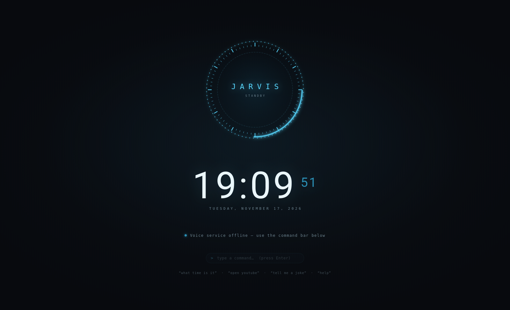

# JARVIS — Voice-Activated Desktop Assistant

A voice-activated desktop assistant with a sci-fi HUD interface, inspired by Marvel's J.A.R.V.I.S. Built with Electron and the Web Speech API.



## Features

- 🎙️ **Wake word** — say “Jarvis” to activate it from anywhere in the app
- 🗣️ **Voice commands** — tell the time, open apps, search the web, tell jokes, and more
- ⌨️ **Typed fallback** — a command bar for when you don't want to speak (or have no mic)
- 🌌 **Animated HUD** — segmented cyan ring, live clock, date, and listening waveform
- 🖥️ **Fullscreen by default** — auto-hiding controls for a clean, cinematic display
- 📦 **Linux `.deb`** — ready to install on Linux Mint / Ubuntu / Debian

## Getting started

### Run from source

Requires Node.js 18+.

```bash
git clone https://github.com/icymaster4356/jarvis-desktop.git
cd jarvis-desktop
npm install
npm start
```

> The app starts fullscreen. Move your mouse to reveal the top bar (mic, fullscreen, quit).

### Keyboard shortcuts

| Key | Action |
| --- | --- |
| `M` | Toggle microphone |
| `F` | Toggle fullscreen |
| `Esc` | Quit |

## Voice commands

Try saying:

- _“what time is it”_
- _“open youtube”_ / _“open github”_ / _“open spotify”_
- _“search for electron apps”_
- _“tell me a joke”_
- _“how are you”_
- _“help”_
- _“go to sleep”_
- _“shut down”_

You can also type any of these in the bar at the bottom of the screen.

## Build a `.deb` for Linux Mint

```bash
npm install
npm run dist:deb
```

The installer is written to `dist/Jarvis-<version>-amd64.deb`. Install it with:

```bash
sudo dpkg -i dist/Jarvis-1.0.0-amd64.deb
sudo apt-get install -f   # resolve any missing dependencies
```

## Verify a build

```bash
npx electron tools/smoke-test.js      # loads the UI and submits a test command
npx electron tools/capture-preview.js # regenerates docs/preview.png
```

## Regenerate the icon

The app icon is generated programmatically with Pillow:

```bash
pip install pillow
python3 tools/generate-icon.py
```

## Notes on speech recognition

The Web Speech API uses your browser's/Chromium's online speech service, so an internet connection is needed for voice input. Text-to-speech (the assistant's replies) works offline using installed system voices. If voice input is unavailable, the typed command bar still works fully.

Microphone permission is required. If Chrome/Electron asks, allow it. You can also grant it via **Settings → Privacy → Microphone** in your desktop environment.

## Project structure

```
jarvis-desktop/
├── src/
│   ├── main/
│   │   ├── main.js        # Electron main process, IPC handlers
│   │   └── preload.js     # Secure bridge to the renderer
│   └── renderer/
│       ├── index.html     # HUD markup
│       ├── styles.css     # Visual design
│       └── app.js         # Clock, HUD, voice + command logic
├── build/icons/           # App icons (generated)
├── tools/generate-icon.py # Icon generator
└── package.json           # Scripts + electron-builder config
```

## License

MIT — see [LICENSE](LICENSE).
